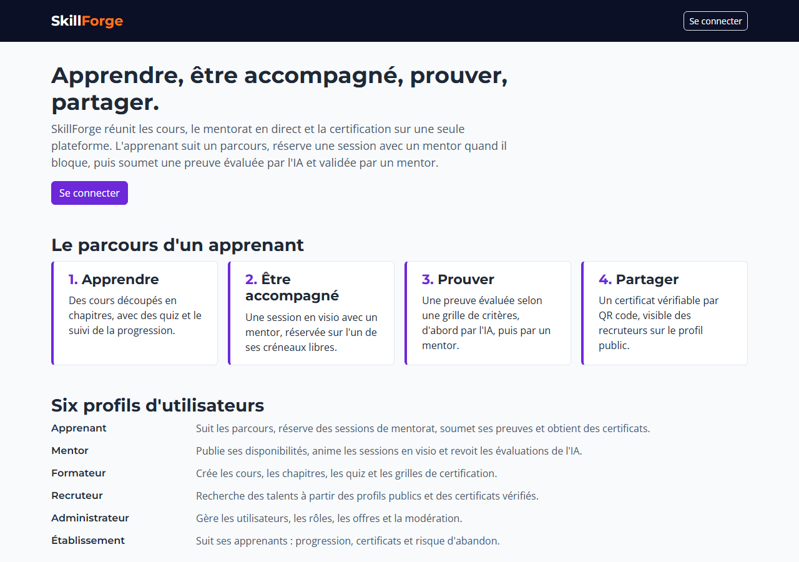

# SkillForge

SkillForge est une plateforme d'e-learning en Django qui réunit les cours, le mentorat en direct et la certification de compétences évaluée par l'IA puis validée par un mentor.

Projet du module « Framework Python pour le Web », classe 5TWIN, ESPRIT, 2026.



## Lancer le projet

Prérequis : Python 3.12 et Git. Docker est facultatif : sans lui, le projet utilise SQLite et exécute les tâches Celery dans le processus web.

```
git clone https://github.com/waeldaagi/Skill-Forge-Legends.git
cd Skill-Forge-Legends
pip install virtualenv
virtualenv venv
venv\Scripts\activate            # Linux/macOS : source venv/bin/activate
pip install -r requirements-dev.txt
copy .env.example .env           # Linux/macOS : cp .env.example .env
```

Dans `.env`, remplacez `SECRET_KEY` par une clé générée avec :

```
python -c "import secrets; print(secrets.token_urlsafe(50))"
```

Puis :

```
python manage.py migrate
python manage.py setup_roles
python manage.py createsuperuser
python manage.py runserver
```

L'application répond sur http://127.0.0.1:8000/ et l'admin Django sur http://127.0.0.1:8000/admin/.

### Avec PostgreSQL et Redis (Docker)

```
docker compose up -d
```

Dans `.env`, décommentez la ligne `DATABASE_URL=postgres://...`, puis relancez `migrate`. Dans un second terminal, démarrez le worker Celery :

```
celery -A config worker -l info --pool=solo      # --pool=solo est nécessaire sous Windows
```

Sans Redis, mettez `CELERY_TASK_ALWAYS_EAGER=True` dans `.env` : les tâches s'exécutent alors dans la requête web, sans worker.

`http://127.0.0.1:8000/health/` indique l'état de la base et de Redis.

## Comptes de démo

La commande `seed_demo` (Phase 5) créera un compte par rôle. En attendant, `createsuperuser` crée un compte administrateur ; les autres comptes se créent dans l'admin Django, en choisissant leur rôle.

## Modules et responsables

| App | Module | Responsable |
|---|---|---|
| `core` | Socle commun : gabarits, permissions, service IA, erreurs | Wael Daagi |
| `accounts` | Comptes et rôles | Taha Liouane |
| `courses` | Catalogue et cours | Taha Liouane |
| `mentoring` | Mentorat en direct | Wael Daagi |
| `community` | Communauté : forum, entraide | Wael Daagi |
| `assessment` | Évaluation et preuve (certification IA), espace recruteur | Hamdi Ben Rayana |
| `payments` | Paiements et offres | Ismail Belhoula |
| `analytics` | Pilotage et analytics | Ismail Belhoula |

Branches : `main` (version validée), `develop` (intégration), `feature/<app>` (une par module, créée depuis `develop`).

## Tests et couverture

```
python manage.py test           # ou : pytest
coverage run manage.py test && coverage report && coverage html
```

`manage.py test` et `pytest` utilisent les mêmes réglages (`config.settings.test`) : Celery synchrone, fournisseur d'IA `mock`, aucun appel réseau.

État au 25/10/2026 (fin de la Phase 0) : 79 tests, couverture de 96 %. La CI GitHub Actions refuse une couverture inférieure à 75 %.

## Déploiement

Prévu en Phase 5. L'URL publique sera indiquée ici.

## Documentation

- `CLAUDE.md` : règles du projet, contrats entre modules, socle IA, commandes de référence.
- `docs/accessibilite.md` : structure accessible des pages et tableau des contrastes.
- `docs/modules/` : une fiche par module (objectif, modèle, URLs, choix techniques, questions du jury).
- `docs/ia/` : un rapport par fonctionnalité IA, avec les métriques mesurées (à partir de la Phase 1).
