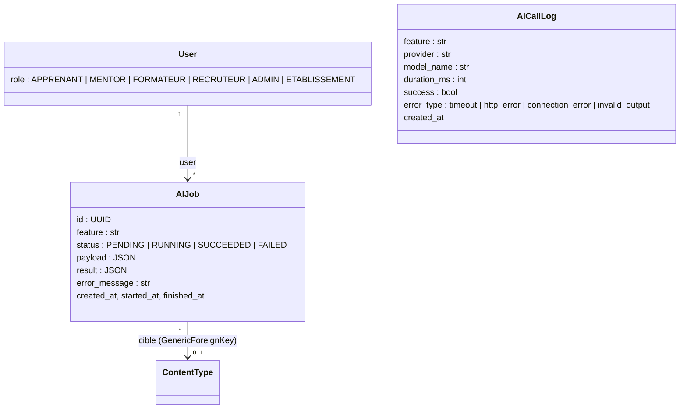

# Module `core` : socle commun

Responsable : Wael Daagi. État au 25/10/2026 : fin de la Phase 0.

## 1. Objectif et acteurs

`core` fournit ce que tous les modules partagent : le gabarit accessible, la navigation selon le rôle, le contrôle d'accès, les pages d'erreur, l'envoi d'e-mails par Celery et le socle IA. Il ne porte aucune règle métier propre à un acteur. Les six acteurs l'utilisent à travers les autres modules.

## 2. Modèle de données

`AICallLog` n'a aucun lien vers un utilisateur : le journal des appels ne contient aucune donnée personnelle. Le test `test_call_log_has_no_field_for_personal_data` protège cette règle.

## 3. URLs

| URL | Vue | Accès |
|---|---|---|
| `/` | `HomeView` | Tous |
| `/health/` | `health` (JSON, GET) | Tous ; 200 si la base et Redis répondent, 503 sinon |
| `/ia/taches/<uuid>/statut/` | `AIJobStatusView` | Propriétaire du job ; autre utilisateur : 404 ; anonyme : redirection vers la connexion |
| `/comptes/connexion/`, `/comptes/deconnexion/` | Vues d'authentification de Django | Tous (déconnexion en POST) |

## 4. Flux principaux

**Traitement IA asynchrone.** Une vue métier appelle `run_ai_job(feature, user, target, payload)`. Le job est créé en `PENDING`, puis la tâche Celery `execute_ai_job` part à la validation de la transaction. La page affiche `` : une zone `role="status"` que HTMX actualise toutes les 2 s. La tâche passe le job en `RUNNING` et appelle `feature.run(job)`, qui utilise `complete_json`. En cas de succès, le résultat est stocké et la vue de statut répond 286 : HTMX arrête le polling. En cas d'échec définitif, le job passe en `FAILED` avec un message en français et le repli métier de la fonctionnalité s'applique.

**Appel au fournisseur.** `complete_json` ajoute au prompt système la consigne anti-injection et le schéma JSON attendu, appelle le fournisseur, puis valide la réponse avec pydantic. Une réponse invalide est redemandée une fois, avec les erreurs de validation. Chaque tentative crée un `AICallLog` avec sa durée.

**Contrôle d'accès.** `RoleRequiredMixin` hérite de `LoginRequiredMixin` : un anonyme est redirigé vers la connexion, un rôle absent de `allowed_roles` reçoit une `PermissionDenied`, affichée par la page 403 avec son message. `OwnerRequiredMixin` filtre le queryset sur le propriétaire.

## 5. Choix techniques justifiés

- **Celery pour l'IA.** Un appel au modèle prend plusieurs secondes et peut échouer. Dans la vue, il bloquerait un worker gunicorn et l'utilisateur. Avec Celery, la page répond tout de suite et affiche l'avancement.
- **`transaction.on_commit` avant `delay`.** Sans cela, le worker peut lire la base avant que le job y soit écrit. Le même principe vaut pour `queue_email` : une réservation annulée par un rollback n'envoie aucun e-mail.
- **Relances limitées aux erreurs passagères.** Un timeout, un 429 ou un 5xx peuvent réussir au second essai. Une clé refusée (401) ou une réponse invalide ne s'arrangeront pas : on échoue tout de suite. Au maximum deux relances, avec un backoff de 2 s puis 4 s.
- **Code 286 pour arrêter le polling.** C'est le code prévu par HTMX : le serveur décide de la fin du polling, aucun JavaScript n'est à écrire.
- **404 plutôt que 403 sur l'objet d'autrui.** Le visiteur n'apprend même pas que l'objet existe.
- **Permissions et liens déclarés dans l'`AppConfig` de chaque app.** Chaque membre modifie son propre module sans toucher au code des autres. `setup_roles` et le context processor agrègent ces déclarations.
- **Fournisseur `mock` déterministe.** Les tests et la CI ne dépendent ni du réseau ni d'une clé. La démo reste possible hors ligne, et le jury voit le même comportement à chaque essai.
- **pydantic pour la sortie de l'IA.** Le modèle peut renvoyer un JSON incomplet ou hors des valeurs prévues. La validation le détecte avant que la donnée touche la base.

## 6. Socle IA

Le module `core` n'a pas de fonctionnalité IA propre. Il fournit le socle utilisé par les quatre fonctionnalités des autres modules : génération de quiz, modération, évaluation des preuves, risque d'abandon.

- Prompt : chaque module écrit le sien. Le socle ajoute la consigne anti-injection et le schéma JSON du modèle pydantic. Le texte de l'utilisateur est encadré par `delimit_user_content`, qui retire toute balise de fermeture glissée dans le texte.
- Sortie : un modèle pydantic par fonctionnalité.
- Mesures : `AICallLog` enregistre la durée et le résultat de chaque appel. Le tableau de bord administrateur (Phase 4) en tirera la latence moyenne, la latence p95 et le taux d'échec par fonctionnalité.
- Fournisseurs : `mock` pour les tests, la CI et la démo hors ligne ; `gemini` en réel (API `generateContent`, modèle `gemini-3.5-flash-lite` par défaut), comme dans l'atelier IA du cours. Essai réel du 25/10/2026 : `gemini-3.8-flash` renvoyait HTTP 503 (forte demande) ; `gemini-3.5-flash-lite` a classé correctement un message normal et un spam, en 1,0 à 1,3 s par appel.
- Limites : deux appels réels seulement à ce stade ; les métriques viendront des commandes `evaluate_*`. Les relances Celery s'ajoutent à la relance pour JSON invalide : dans le pire cas, un job fait 6 appels.

## 7. Tests

85 tests au 25/10/2026, couverture globale de 96 % (`pytest --cov`). Pour `core` :

- fournisseur Gemini : clé dans l'en-tête, JSON imposé, modèle configurable, erreur 503, réponse bloquée, clé absente ;
- client IA : réponse valide, journalisation, timeout, erreurs 401 et 503, service injoignable, JSON invalide puis corrigé, JSON invalide deux fois, fournisseur inconnu, consigne anti-injection présente ;
- tâches IA : succès, échec avec repli, deux relances puis échec, erreur passagère puis succès, erreur inattendue, fonctionnalité non enregistrée ;
- vue de statut : propriétaire, autre utilisateur (404), anonyme (redirection), code 286 en fin de traitement ;
- permissions : chaque mixin, avec chaque rôle autorisé et refusé ;
- pages d'erreur, échec CSRF, formulaires accessibles, accueil et navigation par rôle, `/health/`, e-mails.

## 8. Questions probables du jury

1. **Pourquoi Celery plutôt qu'un appel direct dans la vue ?** L'appel dure plusieurs secondes et peut échouer. Celery le sort de la requête : la page répond tout de suite, le statut se met à jour seul et les relances se font sans bloquer personne.
2. **Que se passe-t-il si l'API d'IA tombe pendant la démo ?** La tâche relance deux fois, puis passe le job en `FAILED` avec un message clair et applique le repli du module. Pour la démo, `AI_PROVIDER=mock` rend le comportement indépendant du réseau.
3. **Comment empêchez-vous un utilisateur de lire le job d'un autre ?** `AIJobStatusView` utilise `OwnerRequiredMixin` : le queryset est filtré sur `user=request.user`, donc l'objet d'autrui donne 404. Test : `test_another_user_cannot_read_the_job`.
4. **Pourquoi `transaction.on_commit` ?** Le worker Celery est un autre processus. Si la tâche part avant le commit, il ne trouve pas encore le job en base.
5. **Comment se protège-t-on de l'injection de prompt ?** Le texte de l'utilisateur est encadré par des balises dont il ne peut pas sortir, et le prompt système demande d'ignorer toute consigne qu'il contient. La sortie est validée par un schéma strict : une réponse hors du format prévu est rejetée.
6. **Où est la clé de l'API ?** Dans `.env` (`AI_API_KEY`), lu par django-environ. `.env` est dans `.gitignore`, seul `.env.example` est versionné.
7. **Pourquoi `RoleRequiredMixin` plutôt que `PermissionRequiredMixin` ?** Les accès du cahier des charges s'expriment par rôle. Les groupes et leurs permissions existent aussi (`setup_roles`) et servent à l'admin Django ; `PermissionRequiredMixin` reste utilisable pour une permission fine.
8. **Comment mesurez-vous le temps de réponse de l'IA ?** Chaque appel crée un `AICallLog` avec `duration_ms`, mesurée par `time.perf_counter()`. Les commandes `evaluate_*` calculent moyenne, médiane et p95.
9. **Pourquoi des pages 403, 404 et 500 personnalisées ?** Elles gardent la navigation et expliquent quoi faire, sans exposer d'information technique. La page 500 est rendue sans contexte de requête, car la panne peut venir de la base.
10. **Que vérifie `/health/` ?** La connexion à la base et un `PING` Redis, avec un délai d'une seconde. Le conteneur web s'en servira comme healthcheck en Phase 5.
