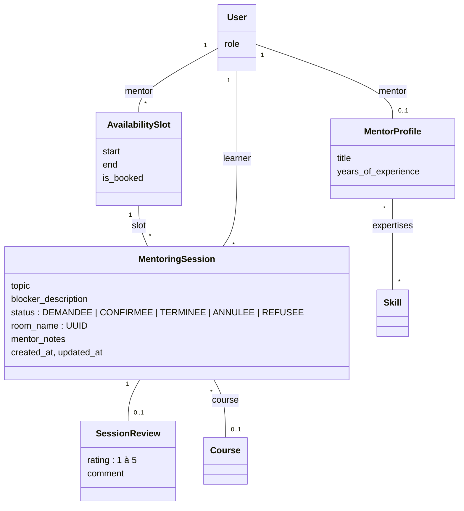
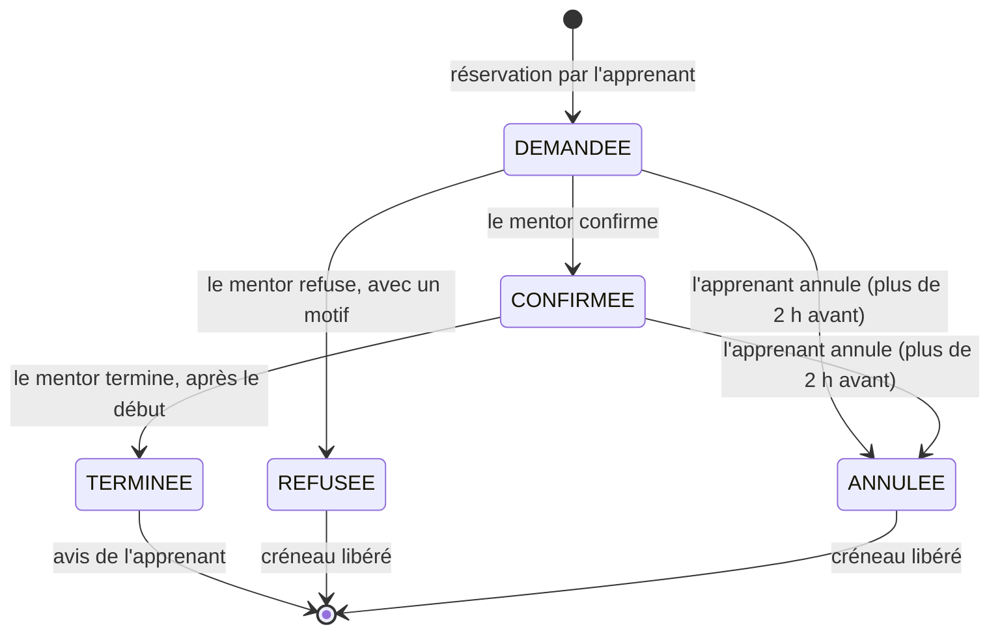

# Module `mentoring` : mentorat en direct

Responsable : Wael Daagi. État au 25/10/2026 : Phase 2, intégrée avec la Phase 1 (branche `integration/phases-0-1-2`).

## 1. Objectif et acteurs

Quand un apprenant bloque, il réserve une session en visio avec un mentor, sur l'un de ses créneaux libres.

- **Mentor** : publie ses créneaux, confirme ou refuse les demandes, anime la session, la termine avec ses notes.
- **Apprenant** : cherche un mentor, réserve un créneau, annule jusqu'à 2 h avant, donne son avis après la session.
- **Administrateur** : consulte les données dans l'admin Django (lecture seule).

## 2. Modèle de données

Contraintes :

| Règle | Où |
|---|---|
| Fin après début | `CheckConstraint` en base et `clean()` |
| Créneau dans le futur, durée de 30 à 120 min, aucun chevauchement pour le même mentor | `AvailabilitySlot.clean()` |
| Une seule session active (demandée, confirmée ou terminée) par créneau | `UniqueConstraint` partielle `one_active_session_per_slot` |
| Note de 1 à 5 | validators et `CheckConstraint` |
| Un avis par session | `OneToOneField` |
| Profil réservé au rôle Mentor | `MentorProfile.clean()` et `limit_choices_to` |
| Seul un mentor vérifié par un administrateur apparaît dans l'annuaire, publie des créneaux et peut être réservé | `services.mentor_directory`, `ensure_can_publish`, `book_slot` |

**Écart au plan initial.** Le plan prévoyait un `OneToOne` entre session et créneau. Avec un `OneToOne`, une session annulée bloquerait le créneau à jamais. La session pointe donc vers le créneau par une clé étrangère, et la contrainte unique partielle garantit qu'un créneau n'a jamais deux sessions actives. L'historique des sessions annulées reste conservé.

**Liens avec la Phase 1.** Les expertises d'un mentor sont des `Skill` (module `accounts`) et servent de filtre dans l'annuaire. Une session peut citer le cours concerné, choisi parmi les cours publiés auxquels l'apprenant est inscrit. Le champ `User.is_verified` est coché par un administrateur dans l'admin Django.

## 3. URLs et rôles

| URL | Vue | Accès |
|---|---|---|
| `/mentorat/mentors/` | `MentorDirectoryView` | Apprenant |
| `/mentorat/mentors/<id>/` | `MentorDetailView` | Apprenant |
| `/mentorat/creneaux/<id>/reserver/` | `SlotBookView` | Apprenant |
| `/mentorat/profil/` | `MentorProfileEditView` | Mentor |
| `/mentorat/creneaux/` | `SlotListView` | Mentor (ses créneaux) |
| `/mentorat/creneaux/nouveau/` | `SlotCreateView` | Mentor |
| `/mentorat/creneaux/<id>/modifier/` et `/supprimer/` | `SlotUpdateView`, `SlotDeleteView` | Mentor propriétaire ; autre mentor : 404 ; créneau réservé : 403 |
| `/mentorat/sessions/` | `SessionListView` | Apprenant et mentor (leurs sessions) |
| `/mentorat/sessions/<id>/` et `/salle/` | `SessionDetailView`, `SessionRoomView` | Les deux participants ; autres : 404 ; salle fermée : 403 |
| `/mentorat/sessions/<id>/confirmer/` (POST), `/refuser/`, `/terminer/` | `SessionConfirmView`, `SessionRefuseView`, `SessionCompleteView` | Mentor de la session ; autre mentor : 404 |
| `/mentorat/sessions/<id>/annuler/`, `/avis/` | `SessionCancelView`, `SessionReviewView` | Apprenant de la session ; autre apprenant : 404 |

Partout : visiteur anonyme redirigé vers la connexion (302), autre rôle refusé (403). Ce tableau est vérifié URL par URL et rôle par rôle dans `mentoring/tests/test_permissions.py`.

## 4. Flux principaux

**Réservation.** L'apprenant choisit un mentor dans l'annuaire, puis un créneau libre, et décrit son blocage. `book_slot` ouvre une transaction, verrouille la ligne du créneau (`select_for_update`), vérifie qu'il est libre et futur, le marque réservé, crée la session « Demandée » et prépare les deux e-mails, envoyés après la validation de la transaction.

**Cycle de vie d'une session.**

**Visio.** La salle Jitsi (`https://meet.jit.si/SkillForge-<uuid>`) s'ouvre 15 minutes avant le début d'une session confirmée et ferme à sa fin. Seuls les deux participants y accèdent.

**E-mails** (tâches Celery) : demande reçue (mentor) et envoyée (apprenant), confirmation, refus avec motif, annulation, et rappel 1 h avant à la confirmation (`apply_async(eta=…)`). Au moment de partir, le rappel vérifie que la session est toujours confirmée.

## 5. Choix techniques justifiés

- **`select_for_update` dans `transaction.atomic`.** Deux apprenants peuvent valider le même créneau à la même seconde. Sous PostgreSQL, le second attend la fin de la transaction du premier, puis voit le créneau réservé et reçoit « Ce créneau vient d'être réservé ».
- **Contrainte unique partielle en plus du verrou.** Si un code oubliait le verrou, la base refuserait quand même une seconde session active (`IntegrityError`). Deux barrières indépendantes.
- **Clé étrangère plutôt que `OneToOne`** : voir l'écart au plan, section 2.
- **E-mails après `transaction.on_commit`.** Une réservation annulée par un rollback n'envoie aucun e-mail.
- **Rappel qui revérifie le statut.** Une tâche planifiée ne s'annule pas facilement ; la tâche contrôle donc elle-même que la session n'a pas été annulée entre-temps.
- **404 sur l'objet d'autrui, 403 sur un rôle interdit.** Un mentor ne peut pas savoir si le créneau d'un autre existe. Les objets sont chargés après le contrôle de rôle (`cached_property`) : un anonyme est redirigé avant toute requête sur l'objet.
- **Règles dans `services.py`, vues fines.** Chaque règle (2 h, 15 min, statuts autorisés) existe à un seul endroit et lève une exception métier dont le message s'affiche tel quel.
- **Jitsi en iframe et lien de secours.** L'iframe a un `title` et les permissions caméra, micro, plein écran et partage d'écran. Le service public meet.jit.si peut limiter les conférences intégrées dans un autre site ; le lien « ouvrir dans un nouvel onglet » reste toujours disponible.
- **Heures de Tunis.** Les dates sont stockées en UTC (`USE_TZ`) et affichées à l'heure de Tunis, avec des espaces insécables dans « 14 h 00 ».

## 6. Intelligence artificielle

Ce module n'a pas de fonctionnalité IA : la fonctionnalité IA de Wael est la modération automatique du module `community` (voir `docs/modules/community.md` et `docs/ia/moderation.md`).

## 7. Tests et accessibilité

110 tests au 25/10/2026, couverture du module de 99 % (`pytest --cov=mentoring mentoring`) :

- modèles (16) : chaque règle de `clean()`, bornes 30 et 120 min incluses, contraintes en base, double session active refusée par la base ;
- services (32) : réservation, mentor non vérifié, créneau déjà pris, objet périmé qui ne contourne pas le verrou, confirmation, refus, fin, annulation à 2 h 01 (acceptée) et 1 h 59 (refusée), avis, fenêtre de la salle, e-mails, rappel ;
- formulaires (9), vues (42), dont le filtre par expertise, le choix du cours concerné, le refus d'un mentor non vérifié et une vérification que le nombre de requêtes de l'annuaire ne grandit pas avec le nombre de mentors ;
- matrice d'accès (7 tests, 112 combinaisons : 16 URL × 6 rôles et l'anonyme) ;
- données de démo (4).

Audit Lighthouse 13.5.0, le 25/10/2026, sur les données de démo : 100/100 en accessibilité pour l'annuaire, le détail d'un mentor, la réservation, la liste des sessions, une demande vue par le mentor, la liste des créneaux et le formulaire de créneau. Aucun débordement horizontal à 375 px.

Limite des tests : un `TestCase` ne reproduit pas deux transactions simultanées. La garantie testée est celle du service (une seconde réservation lève `SlotUnavailable`) et celle de la base (contrainte unique). La CI exécute ces tests sous PostgreSQL, où `select_for_update` pose réellement le verrou.

## 8. Questions probables du jury

1. **Et si deux apprenants réservent le même créneau à la même seconde ?** Le premier verrouille la ligne avec `select_for_update` ; le second attend, puis voit `is_booked=True` et reçoit un message clair. Même sans verrou, la contrainte unique partielle refuserait la seconde session.
2. **Pourquoi pas un `OneToOneField` entre session et créneau ?** Une session annulée garderait le créneau pour toujours. La FK et la contrainte partielle libèrent le créneau sans effacer l'historique.
3. **Montrez la ligne qui empêche un mentor de modifier le créneau d'un autre.** `EditableSlotMixin` hérite d'`OwnerRequiredMixin` avec `owner_field = "mentor"` : le queryset est filtré sur le mentor connecté, donc l'objet d'autrui donne 404. Test : `test_slot_of_another_mentor_is_not_found`.
4. **Pourquoi 404 et pas 403 sur l'objet d'autrui ?** Un 403 confirmerait que l'objet existe.
5. **Comment testez-vous la règle des 2 h ?** Deux sessions créées à 2 h 01 et 1 h 59 du début : la première s'annule, la seconde lève `CancellationTooLate`.
6. **Pourquoi Celery pour les e-mails ?** Un serveur SMTP lent bloquerait la réponse de la réservation. Le rappel doit partir 1 h avant, longtemps après la requête : seul un worker peut le faire.
7. **Et si la session est annulée après la planification du rappel ?** La tâche relit la session au moment d'envoyer et ne fait rien si elle n'est plus confirmée.
8. **Comment la salle de visio est-elle protégée ?** Le nom de salle est un UUID impossible à deviner, la page n'est accessible qu'aux deux participants, et seulement entre 15 minutes avant le début et la fin d'une session confirmée.
9. **Où sont les règles métier ?** Dans `mentoring/services.py`. Les vues appellent un service, affichent son message et redirigent ; les gabarits n'affichent que des indicateurs calculés par la vue.
10. **Et un mentor qui n'est pas encore vérifié ?** Il peut remplir son profil, mais il n'apparaît pas dans l'annuaire et ne peut pas publier de créneau (page 403 avec le motif). Même par URL directe, son créneau ne peut pas être réservé : `book_slot` le refuse, et un test le prouve.
